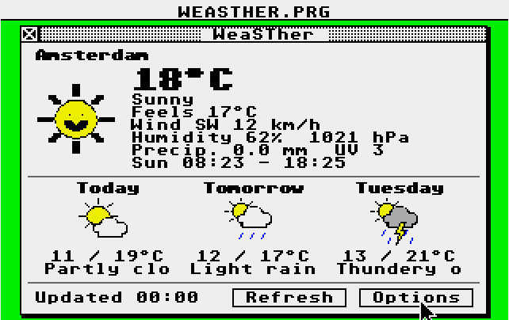

# WeaSTher

A small weather gadget for the Atari ST. It fetches the weather from
[wttr.in](https://github.com/chubin/wttr.in) through the STinG TCP/IP stack
and shows it in a GEM window: current weather with a big icon, and a
three-day forecast.

- Works in ST low (16 colours), medium (4 colours) and high resolution (mono).
  The icons are drawn with VDI calls (sun, clouds, rain, snow, sleet,
  thunder, fog), so they scale to each resolution and its pixel aspect.
- Settings (Options button, or the `O` key): location, language, units
  (metric/imperial) and auto refresh interval. They are stored in
  `WEASTHER.CFG` next to the program, together with the window position.
- Quit: the window's close box, `Esc` or `Q`. `R` refreshes.

## Requirements

- STinG with TCP.STX and RESOLVE.STX loaded and a working network, e.g.
  ACSI2TNFS with ACSI_NET.STX.
- The program runs from any drive, also a TNFS drive (the config file is
  written to the program's folder).

## Settings

| Key        | Meaning                                                    |
|------------|------------------------------------------------------------|
| `location` | City, `~Eiffel+Tower`, airport code, ... Empty: by IP address |
| `lang`     | wttr.in language code (`nl`, `en`, `de`, `fr`, `es`, ...)  |
| `units`    | `metric` or `imperial`                                     |
| `refresh`  | minutes between updates, `0` = only on request             |
| `host`     | `wttr.in` or your own wttr.in instance (plain HTTP, port 80) |
| `window`   | window position `x,y` (`-1,-1` = centred)                  |

On the first start the language follows the TOS country. The interface
texts exist in Dutch, English, German and French; the weather descriptions
come translated from wttr.in in any language. Languages in non-Latin
scripts show `?` for characters the Atari font does not have.

## How it works

- `src/net.c`: finds STinG through the `STiK` cookie and makes a plain
  HTTP/1.0 request (`/<location>?format=j1&lang=<lang>`), polled from the
  GEM event loop so the window stays usable. STinG uses Pure C calling
  conventions (16-bit ints, pointers returned in A0); the program is built
  without `-mshort`, so every call goes through `src/pccall.S`.
- `src/json.c`: walks paths in the JSON text, converts UTF-8 to the Atari
  character set.
- `src/weather.c`: picks the fields; forecast icons use the 12:00 forecast.
- `src/icons.c`: the icons; `src/main.c`: window, layout, settings dialog.

## Building

    make            # WEASTHER.PRG (m68k-atari-mint-gcc, gemlib)
    make test       # host test of the JSON parsing with a saved answer

`test/iconview.c` renders all icons on the host for a quick look:

    gcc -Itest/fakegem -Isrc -o iconview test/iconview.c src/icons.c -lm
    ./iconview icons.ppm
